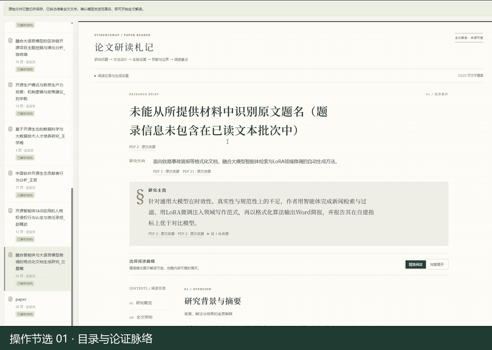
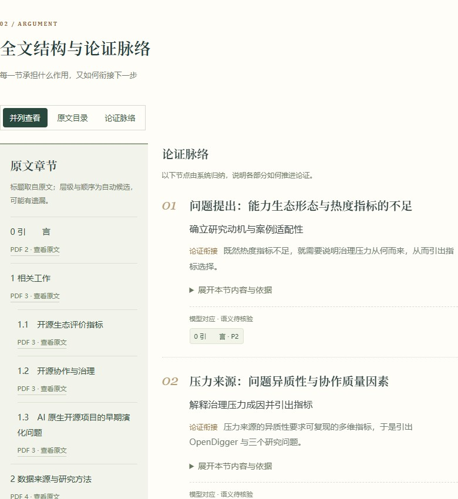
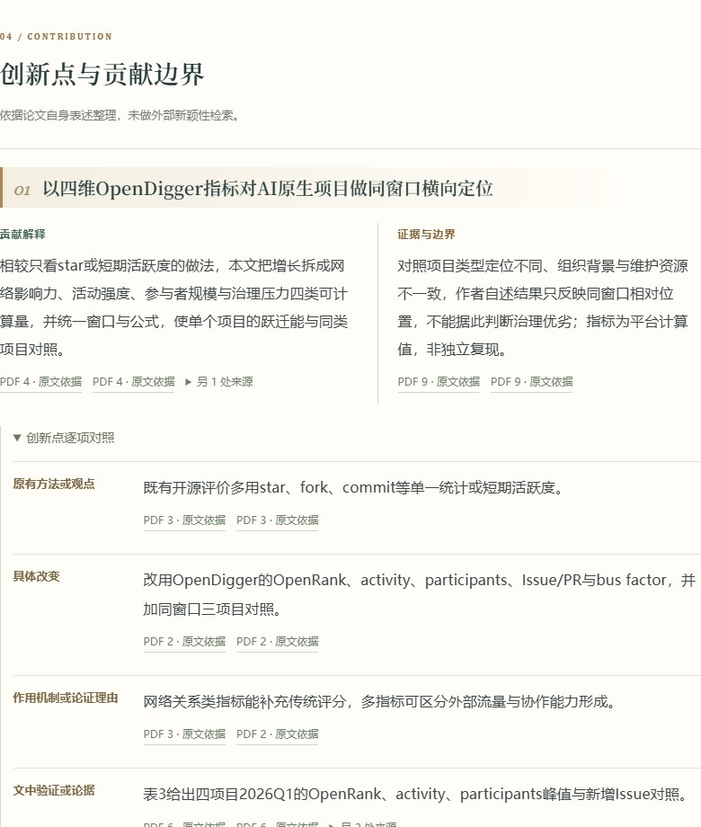
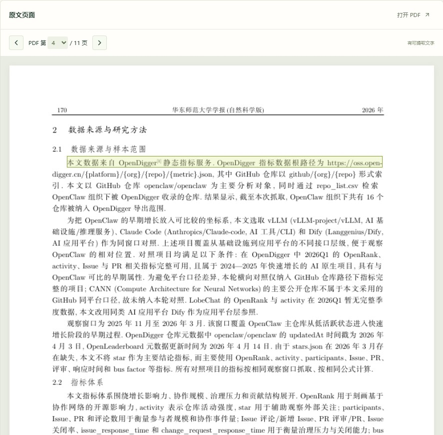
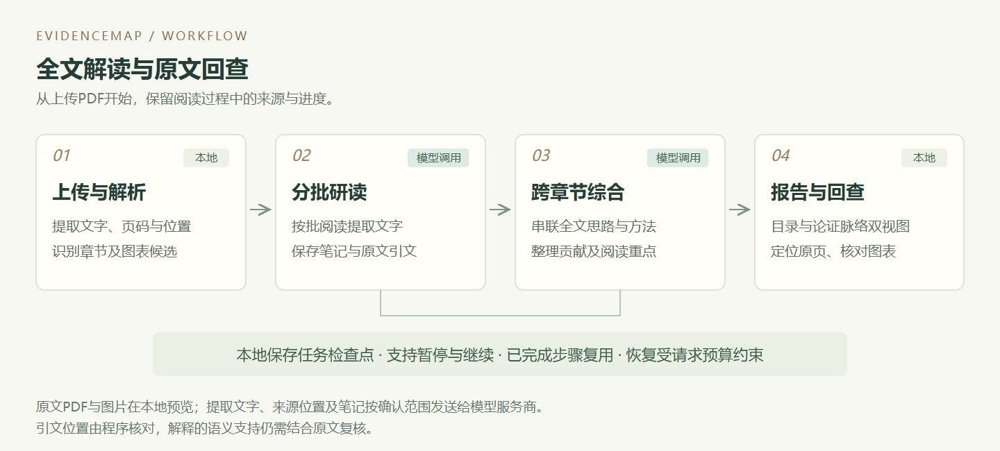

# 研证 EvidenceMap

**理解论文，也看清解释的依据。**

面向研究生与科研人员的可溯源论文解读工具，AI黑客松“科研创新”赛道参赛项目。

上传一篇PDF，梳理作者研究了什么、全文如何展开、方法为什么这样设计、贡献体现在哪里，以及应该重点阅读哪些部分。关键解释保留引文与PDF页码，原文图表可随时打开核对。

[观看演示](#演示与功能) · [快速运行](#快速运行) · [下载五篇样品](#样品论文) · [查看技术设计](#核心设计) · [查看验证情况](#当前验证)

| 阅读时关心的问题 | 可以查看的内容 |
| --- | --- |
| 这篇论文研究什么，为什么值得读？ | 研究方向、背景、摘要解读与研究主旨 |
| 各章节怎样推进到结论？ | 原文目录与论证脉络双视图 |
| 方法如何工作，贡献具体在哪里？ | 核心概念、方法解释与创新点逐项对照 |
| 解释依据在哪里，接下来读哪些部分？ | 原文引文、PDF页码、图表与精读路线 |

## 演示与功能

下方为**16秒循环操作节选**，包含上传论文、全文解读、目录与论证脉络及原文图表。点击动图查看约1分49秒的完整演示。

[](https://gitee.com/feng-zhongchen/ai-hackathon/blob/main/docs/media/evidencemap-demo.mp4)

[打开演示视频](https://gitee.com/feng-zhongchen/ai-hackathon/blob/main/docs/media/evidencemap-demo.mp4) · [下载MP4](https://gitee.com/feng-zhongchen/ai-hackathon/raw/main/docs/media/evidencemap-demo.mp4)

视频等待段作10倍速处理并显示标识，其余部分正常播放；视频时长不代表实际解读耗时。文件页不能预览时，可下载观看。

下面三张图截取自已有的《面向AI Agent能力生态的开源协作治理：OpenClaw案例研究》报告。它们展示当前功能，报告中的模型解释仍需结合原文复核。

### 目录与论证脉络：看清全文怎样展开

左侧保留原文章节，右侧说明各部分在研究问题、方法、证据和结论中的作用。选择章节可查看关联节点，也可回到对应原页。



### 创新点逐项对照：把贡献落到具体改变

按原有方法或观点、具体改变、作用机制、文中依据与适用边界整理，帮助读者判断作者的贡献主张。这里依据论文自身材料，不替代外部新颖性检索。



### 原文回查：带着解释核对依据

点击报告中的引文，跳到相应PDF页并高亮来源区域；原文图片、表格与框架图也可在报告中打开大图核对。



## 核心设计

系统把全文研读、来源定位和任务恢复放进同一条工作流程。以下设计都有对应代码与回归用例。

| 阅读中的难点 | 处理方式 | 实现位置 |
| --- | --- | --- |
| 长论文内容分散，局部笔记难以形成整体理解 | 分批研读保存带来源的笔记，再分段跨章节综合 | [任务编排](backend/evidence/paper_reports.py)、[模型提示与契约](backend/evidence/report_model.py) |
| 看懂目录，却不清楚各节为什么这样安排 | 保留原文目录，并展示系统归纳的论证脉络及对应关系 | [章节组织](backend/evidence/report_structure.py)、[双视图](src/PaperStructure.jsx) |
| 创新点表述笼统，难以辨认具体贡献 | 对照原有方法、改变、机制、依据与边界 | [报告契约](backend/evidence/report_models.py)、[贡献展示](src/PaperReport.jsx) |
| 解读内容难以回到原文核对 | 校验引文片段与位置，回填PDF页码，提供区域高亮 | [引文定位](backend/evidence/report_quotes.py)、[原文阅读器](src/EvidenceWorkspace.jsx) |
| 缺失或矛盾的判断也可能缺乏依据 | 在生成中记录结论、局限与疑问的模型支持自查，保留原文回查 | [支持自查](backend/evidence/report_support.py)、[人工复核入口](src/ReportSupport.jsx) |
| 中途失败导致重复处理已读内容 | 保存已完成步骤与候选结果，支持继续、本地重校验和预算内有限恢复 | [任务检查点与恢复](backend/evidence/paper_reports.py) |

题名通过首页或题录页的字号、位置与连续文字识别，保留原文出处；无法可靠识别时明确使用文件名备用显示，详见[题名识别](backend/evidence/titles.py)。

**引用位置校验与语义支持判断分开处理。** 引文存在不等于解释正确；同次生成的模型自查也不等于独立验证。界面保留人工回查入口，历史报告不会自动重跑或补写自查记录。

## 系统流程



前端使用React/Vite，后端使用FastAPI；PyMuPDF在本地提取文字、页码与位置并渲染原页，SQLite与文件存储保存资料和任务进度。模型由后端适配DeepSeek接口，密钥不进入前端。

生成解读时，提取文字、页码、位置、原文引文及阅读笔记会发送给配置的模型服务商；原始PDF和图片不作为当前全文文字研读请求的附件发送。

## 当前验证

下表为**2026年10月22日**在本机Windows环境的验证记录，对应功能源码版本 `050c7b0`。

| 验证项 | 已完成的检查 |
| --- | --- |
| 后端回归 | 213项通过，包含本机可选LoRA论文样本检查；有1项Starlette依赖弃用警告 |
| 浏览器回归 | 15项通过，覆盖上传、解析、引文定位、报告展示、任务控制及移动端布局等流程 |
| 前端构建 | `npm run build`通过 |
| 五篇体验样品 | 共58页，逐篇本地解析通过，文件哈希与提供的原件一致 |

自动化测试主要使用合成PDF与模拟模型响应，验证工程流程，不代表真实解读准确率。真实论文试读已开展；独立语义正确性、图表理解、新颖性及读者使用收益尚未完成评估。其他实体电脑的完整安装验收、macOS/Linux独立部署也仍待验证。

<details>
<summary>复现工程检查</summary>

安装依赖后，在仓库根目录运行：

```powershell
.\.venv\Scripts\python.exe -m pytest tests -q
npm run build
```

两个后端解析回归及一个浏览器用例依赖可选的 `knowledge/lora/paper.pdf`。仓库未分发该论文：缺少时，两个后端用例自动跳过；浏览器检查按下方命令排除该用例，可运行其余14项，不影响应用运行。

浏览器回归使用Playwright和Microsoft Edge。请使用独立测试资料库，避免向日常资料库写入测试夹具。先在一个PowerShell终端启动测试后端：

```powershell
$env:EVIDENCEMAP_EVIDENCE_DIR = Join-Path $PWD 'dev_data\browser-check'
$env:MODEL_BASE_URL = 'http://127.0.0.1:1'
$env:MODEL_API_KEY = 'browser-check-placeholder'
$env:MODEL_NAME = 'synthetic-browser-check'
.\.venv\Scripts\python.exe -m uvicorn backend.app:app --host 127.0.0.1 --port 8014
```

再在另一个终端运行：

```powershell
$env:EVIDENCEMAP_TEST_URL = 'http://127.0.0.1:8014'
npm run test:browser -- --grep-invert "real LoRA"
```

上面的模型地址指向本机无服务端口，密钥是测试占位符，测试依靠模拟响应，不应发送真实模型请求。若自己备有对应LoRA样本，可去掉 `--grep-invert "real LoRA"` 运行全部15项。结束后在测试后端终端按Ctrl+C并关闭该终端。

</details>

## 快速运行

### 使用前请先确认

本项目需要在自己的电脑上安装启动。先准备Windows、Python 3.13（本机已验证）与Node.js 22或更新版本。

| 配置情况 | 可以体验的功能 |
| --- | --- |
| 无API Key | 本地上传、文字解析、原文定位和图表预览 |
| 自有有效API Key、可用模型及额度，网络可达 | 在上述功能基础上生成全文解读，完成情况受输入质量与模型服务影响 |

当前支持单篇不超过20MB、100页的文字型PDF，扫描版暂无OCR。仓库附带五篇体验论文；首次启动仍为空资料库，需要手动上传。仓库不包含作者的Key或历史报告，调用费用由使用者自己的模型账户承担。

### 安装与模型配置

在仓库根目录打开PowerShell：

```powershell
python -m venv .venv
.\.venv\Scripts\python.exe -m pip install -r requirements.txt
npm ci
npm run build
if (-not (Test-Path .env)) { Copy-Item .env.example .env }
```

需要AI解读时，在本机 `.env` 中填写自己的 `MODEL_BASE_URL`、`MODEL_NAME` 与 `MODEL_API_KEY`。当前适配DeepSeek的Chat Completions与JSON输出；模型名称以自己账户实际支持的名称为准。`.env.example`是模板，不含可用Key。已有 `.env` 时保留原文件，修改模型配置后重启后端。

### 启动工作台

```powershell
.\.venv\Scripts\python.exe -m uvicorn backend.app:app --host 127.0.0.1 --port 8000
```

打开[本地工作台](http://127.0.0.1:8000/)，也可运行 `start.ps1`。这种启动方式需要终端保持运行。

Windows也可后台启动，命令返回后可以关闭终端：

```powershell
.\.venv\Scripts\python.exe -m backend.desktop start --quiet --no-browser
```

后台访问[本地后台工作台](http://127.0.0.1:8002/)，停止时运行：

```powershell
.\.venv\Scripts\python.exe -m backend.desktop stop --quiet
```

后台日志保存在 `dev_data/desktop/`。电脑重启后需再次启动。两个入口共用资料库，避免对同一论文并发生成。macOS/Linux可参考相同依赖与构建步骤，用 `.venv/bin/python` 启动后端；Windows后台入口不适用，其他平台尚未独立验收。

## 样品论文

建议先上传**3页的人才培养研究**，熟悉研究概述、全文架构与阅读路线；再上传**区块链主题论文**，查看方法步骤、指标、图表及创新点对照。

| 样品论文 | PDF页数 | 建议体验内容 |
| --- | --- | --- |
| [基于开源生态的数据科学与大数据技术人才培养研究](examples/papers/基于开源生态的数据科学与大数据技术人才培养研究_王学梅.pdf) | 3 | 短文入门，熟悉完整阅读流程 |
| [融合大语言模型的区块链开源项目主题挖掘与演化分析](examples/papers/融合大语言模型的区块链开源项目主题挖掘与演化分析_饶芮瑞.pdf) | 15 | 方法、指标、图表与创新点对照；演示视频案例 |
| [面向AI Agent能力生态的开源协作治理：OpenClaw案例研究](examples/papers/面向AI_Agent能力生态的开源协作治理：OpenClaw案例研究_耿航航.pdf) | 11 | 案例研究的论证脉络；本页静态截图案例 |
| [开源智能体Skill应用的人格权侵权行为认定与责任承担](examples/papers/开源智能体Skill应用的人格权侵权行为认定与责任承担_赵精武.pdf) | 12 | 概念边界、规范分析与责任论证 |
| [中国软件开源生态贡献者行为分析](examples/papers/中国软件开源生态贡献者行为分析_王哲.pdf) | 17 | 实证研究的数据、方法与结果 |

点击“上传PDF”，在 `examples/papers/` 中选择文件。确认模型发送范围和请求预算后启动全文解读，再查看报告与原文。较长论文通常需要更多请求与等待时间，费用以服务商实际记录为准。

样品不会自动导入，也不附带预生成报告。五篇均为真实论文，保留作者署名及原始PDF，文件说明与校验清单见[样品目录](examples/papers/README.md)。这些是已知开发样品，不作为独立准确率评测集。

## 数据与适用边界

- 密钥只保存在后端环境变量或本机不提交的 `.env` 中。生成解读前，工作台会提示模型发送范围与请求预算。
- 除明确列出的五篇样品及公开演示素材外，其他上传论文、资料库、历史报告、日志、评测笔记与开发记录不随仓库分发。
- 复杂版式、无图题矢量图、跨页表格与公式可能漏检或提取不完整，应结合原页核对；本地显示图表不代表模型已理解其视觉内容。
- 创新点对照基于论文材料，未执行外部新颖性检索；模型支持自查未替代独立语义核验。
- 当前为本地原型，尚无公网多用户鉴权、账户隔离与生产部署安全验证。旧 `/?workspace=legacy` 保留为早期文献对比原型。
- 合成测试与模拟演示须明确标注；处理论文与第三方素材时需具备相应授权。

## 代码结构

| 目录 | 内容 |
| --- | --- |
| [backend/](backend/) | FastAPI、PDF处理、模型适配、任务编排与存储 |
| [src/](src/) | React报告、目录双视图、原文阅读器与图表界面 |
| [design/](design/) | 数据契约与数据库结构 |
| [tests/](tests/) | 后端及浏览器回归，包含合成PDF夹具 |
| [examples/papers/](examples/papers/) | 五篇真实体验样品及文件清单 |
| [docs/media/](docs/media/) | 真实功能截图、流程图及演示视频 |

## 许可

项目许可证见 [LICENSE](LICENSE)（OSL-3.0）。第三方依赖和样品论文分别遵循各自的许可与权利安排，论文作者及出版信息以PDF为准。
