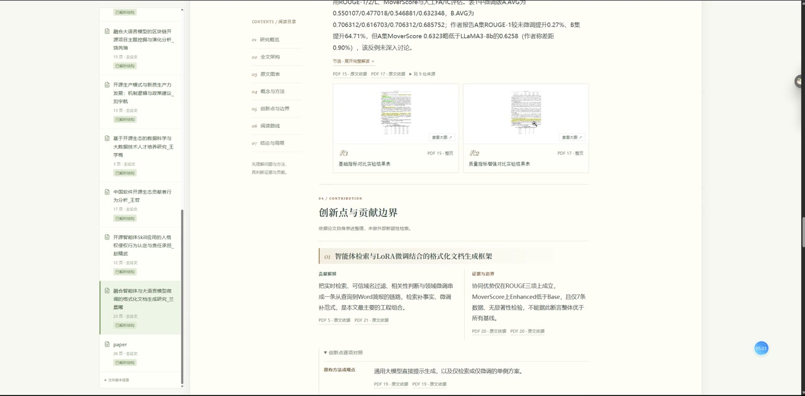

# 研证 EvidenceMap

面向研究生与科研人员的可溯源论文解读工具，AI黑客松“科研创新”赛道参赛项目。

上传PDF后，系统分批研读提取文字、跨章节综合，整理研究方向、摘要解读、全文架构、核心方法、创新点和阅读重点。关键解释保留引文与PDF页码，支持回查原文；原文图片、表格和框架图可在报告中查看。

## 演示视频

**约2分09秒，展示全文研读、解读报告、创新点对照与原文图表回查。** 点击下方封面打开视频：

[](https://gitee.com/feng-zhongchen/ai-hackathon/blob/main/docs/media/evidencemap-demo.mp4)

[打开演示视频](https://gitee.com/feng-zhongchen/ai-hackathon/blob/main/docs/media/evidencemap-demo.mp4) · [下载MP4后观看](https://gitee.com/feng-zhongchen/ai-hackathon/raw/main/docs/media/evidencemap-demo.mp4)

视频中的等待过程已作10倍速处理，并显示快进标识；其余部分正常播放。视频时长不代表实际全文解读耗时。若文件页无法直接预览，可下载后用本地播放器观看。

## 使用前请先确认

本项目需要在自己的电脑上安装和启动，拉取代码后请先完成以下准备：

1. **运行环境**：Windows电脑安装Python 3.13、Node.js 22或更新版本；按下方步骤创建虚拟环境、安装依赖并构建前端。
2. **模型配置**：完整AI解读需要自行准备DeepSeek API Key，在本机`.env`中配置有效的接口地址、模型名称和Key，确保账户有可用额度、网络可访问接口。`.env.example`仅为配置模板，不包含可用Key，模型名称需按自己账户实际支持情况填写。
3. **启动服务**：完成安装后启动后端，在浏览器打开本地工作台，再上传论文。修改模型配置后需重启后端。
4. **论文要求**：当前支持文字型PDF，扫描版暂无OCR；复杂版式和图表可能漏检，需要结合原页核对。

| 配置情况 | 可以使用的功能 |
| --- | --- |
| 未配置API Key | 本地上传、文字解析、原文定位和图表预览 |
| 已配置有效API Key，且有额度、网络可用 | 在上述功能基础上，进行全文AI研读并生成解读报告；实际完成情况仍受模型服务与输入质量影响 |

**仓库不提供作者的API Key、论文原件、历史报告或本地资料库。** 首次运行从空资料库开始，需自行上传允许处理的论文。生成解读时，提取文字、页码、位置及阅读笔记会发送给配置的模型服务商，调用费用由使用者账户承担。

当前主要验证环境为Windows；已完成不含私有材料的干净源码测试，但尚未在另一台实体电脑上完成完整安装验收，macOS/Linux也未完成独立部署验证。

## 核心设计

- **目录与论证双视图**：并列呈现章节安排及各节在问题、方法、证据和结论中的作用。
- **创新点逐项对照**：整理原有方法或观点、具体改变、作用机制、文中依据与适用边界。
- **证据回查**：关键解释关联引文与页码。引用位置校验与语义支持判断分别处理，引文存在不等于解释正确。
- **原文图表**：本地渲染，支持大图、整页与原文定位。无图题嵌入原图及识别失败页标为“待核对”。
- **阅读路线**：提供阅读顺序、关注问题和必要基础，保留阅读缺口。
- **长文任务**：保存笔记与进度，支持暂停继续、有限重试及分段综合，请求受用户确认的总预算约束。

## Windows快速运行

需要Python 3.13（已验证环境）、Node.js 22或更新版本。在仓库根目录打开PowerShell：

```powershell
python -m venv .venv
.\.venv\Scripts\python.exe -m pip install -r requirements.txt
npm ci
npm run build
if (-not (Test-Path .env)) { Copy-Item .env.example .env }
```

已有`.env`时保留原文件。编辑`MODEL_BASE_URL`、`MODEL_NAME`和`MODEL_API_KEY`，填入自己账户的有效配置；模型名称以服务商控制台为准。当前适配DeepSeek的Chat Completions及JSON输出。

```powershell
.\.venv\Scripts\python.exe -m uvicorn backend.app:app --host 127.0.0.1 --port 8000
```

打开[本地工作台](http://127.0.0.1:8000/)，也可运行`start.ps1`。修改模型配置后重启后端。

Windows后台入口（启动命令返回后可关闭终端）：

```powershell
.\.venv\Scripts\python.exe -m backend.desktop start --quiet --no-browser
.\.venv\Scripts\python.exe -m backend.desktop stop --quiet
```

后台访问[本地后台工作台](http://127.0.0.1:8002/)，日志在`dev_data/desktop/`。两个入口共用资料库，避免对同一论文并发生成。macOS/Linux可使用相同依赖和构建流程，以`.venv/bin/python`运行后端；未完成独立Linux部署验证，Windows后台入口不适用。

## 使用与测试

上传允许处理的PDF，确认外发范围和请求预算，启动全文解读，再查看报告、原文图表、创新点对照及精读路线。没有Key时可使用本地上传、解析、原文定位及图表预览；真实解读需要模型配置及额度。配置就绪不等于已验证服务商鉴权。

```powershell
.\.venv\Scripts\python.exe -m pytest -q
npm run build
```

测试主要使用合成PDF及模拟模型响应，验证协议、引用定位、恢复与界面逻辑，不代表真实科研准确率。两个真实论文解析回归依赖可选的`knowledge/lora/paper.pdf`；仓库不分发该论文，缺少时相应测试跳过。浏览器测试需要Playwright的Microsoft Edge运行环境及已启动后端，运行`npm run test:browser`。

真实论文试读已进行，但尚未完成独立的语义正确率、新颖性或图表理解效果评估。旧`/?workspace=legacy`为早期文献对比原型，当前主线是全文解读。

## 数据与边界

- Key仅保存在后端`.env`或环境变量，不进入前端或仓库。
- 解读会向配置的模型服务商发送提取文字、页码、位置及笔记；原图预览本地渲染，不等于视觉模型已经理解图表。
- 上传论文、数据库、日志、评测原件及开发交接不随仓库分发，首次运行从空资料库开始。
- 支持文字型PDF，暂无OCR；复杂版式、无图题矢量图、跨页表和远处注释可能漏检，应通过原页核对。
- 引用可定位不代表解释已获得语义证明，创新点对照基于论文材料，未执行外部新颖性检索。
- 本地原型尚无公网多用户鉴权、账户隔离及生产部署安全验证。
- 模拟演示必须标注，论文及第三方素材的授权由使用者确认。

## 代码位置

| 目录 | 内容 |
| --- | --- |
| `backend/` | FastAPI、PDF处理、任务编排、模型适配与存储 |
| `src/` | React报告、原文阅读器与图表界面 |
| `design/` | 数据契约与数据库结构 |
| `tests/` | 后端及浏览器回归，包含合成PDF样本 |

本仓库只提供应用源码、测试及必要运行配置。论文原件、评测笔记、开发过程文档和本地资料库不上传。
